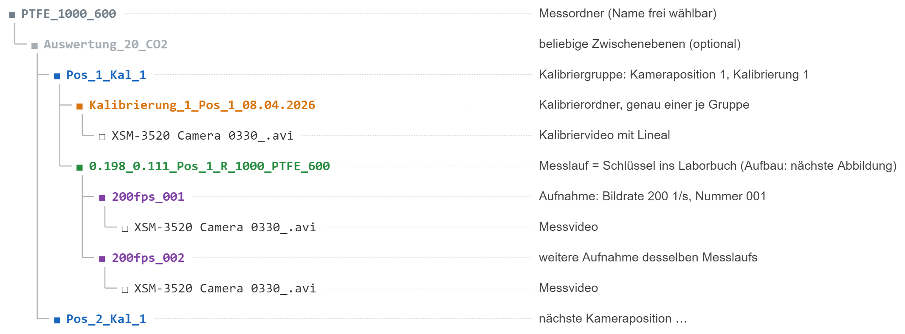
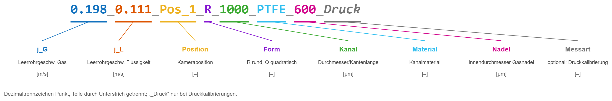

# 2 Messdaten

Die Auswertung findet Videos, Kalibrierung und Metadaten allein über
Ordnernamen und das Laborbuch. Dieses Kapitel beschreibt, wie beides
aussehen muss und wie eine neue Messreihe hinzukommt.

## 2.1 Ordnerstruktur

Die Farben stehen für die Ebenen, die das Programm erkennt. Nur die
Kalibriergruppe, der Kalibrierordner, der Messlauf und die Aufnahme haben
feste Namensregeln; Messordner und Zwischenebenen sind frei benennbar.

**Kalibriergruppe `Pos_<n>_Kal_<k>`.** Kameraposition n und Nummer k der
Kalibrierung. Unterhalb eines Gruppenordners muss genau ein Kalibriervideo
liegen, in einem Ordner, dessen Name mit `Kalibrierung_` beginnt
(`cfg.kalibrierung.ordnermuster`). Alle Messläufe darunter verwenden dieses
Kalibriervideo. Fehlt es oder gibt es mehrere, bricht die Auswertung dieses
Videos mit einer Meldung ab.

**Messlauf.** Der Ordnername ist der Schlüssel ins Laborbuch und enthält
die Einstellungen des Versuchs:

Ohne den Zusatz `_Druck` gilt die Messung als Stoffübergangsmessung
(Massentransfer).

**Aufnahme `<n>fps_<nnn>`.** Bildrate n [1/s] und laufende Nummer. Mehrere
Aufnahmen desselben Messlaufs werden getrennt ausgewertet und in der
Spalte `Aufnahme` unterschieden. Liegt das Video direkt im Messlauf, gilt
die Bildrate `cfg.video.fps`.

**Videodatei.** Gesucht werden Dateien nach `cfg.video.dateimuster`
(Standard `XSM-3520 Camera 0330_*.avi`). Weitere Dateien der Kamera
(`.mii`, `.mme`, `.xsv`) werden nicht gelesen.

## 2.2 Laborbuch

Datei `data/Laborbuch.csv` (`cfg.pfade.laborbuch`), Trennzeichen Semikolon,
Dezimalpunkt, eine Zeile je Messlauf. Pflichtspalten:

| Spalte | Bedeutung | Einheit | Beispiel |
|---|---|---|---|
| `Dateiname` | Name des Messlauf-Ordners (Schlüssel) | – | `0.198_0.111_Pos_1_R_1000_PTFE_600` |
| `Offset` | Position des rechten Bildrands im Reaktor | mm | `0` |
| `Umgebungsdruck` | Druck am Auslass | Pa | `101610` |
| `Umgebungstemperatur` | Temperatur | °C | `22.1` |
| `CO2-Anteil` | Stoffmengenanteil CO₂ im Gas | – (0…1) | `0.2` |
| `Kanallaenge` | Länge des Reaktors | cm | `72` |

Fehlt die Zeile oder ist eine Pflichtangabe leer, wird das Video im Batch
mit einer Warnung übersprungen (`ÜBERSPRUNGEN: …` im Protokoll); die
Einzelauswertung bricht mit derselben Meldung ab. Weitere Spalten des
Laborbuchs werden nicht gelesen.

Für Druckkalibrierungen setzt `cfg.laborbuch.co2_anteil_druck` den
CO₂-Anteil unabhängig vom Laborbuch (Standard 0, siehe Kapitel 3).

Steht ein `Dateiname` doppelt im Laborbuch, gilt die erste Zeile.

## 2.3 Neue Messreihe hinzufügen

1. Videos in der Struktur aus 2.1 ablegen, z. B. als neuen Messordner
   `PVC_1500_1150/` im Projektordner. Je Kameraposition und Kalibrierung
   ein Ordner `Pos_<n>_Kal_<k>` mit genau einem Kalibrierordner.
2. Je Messlauf eine Zeile im Laborbuch ergänzen (Pflichtspalten aus 2.2).
   `Dateiname` muss exakt dem Ordnernamen entsprechen.
3. In `run_Batch.m` den Messordner eintragen und `run_Batch` ausführen.
4. Im Protokoll prüfen:
   - `Gruppe Pos_…: … mm/px` bzw. `Kalibrierdatei: …` – Kalibrierung gefunden
   - keine Zeilen `ÜBERSPRUNGEN` für die neuen Messläufe
   - `ERFOLG: … Zeilen gespeichert in …`
5. Ergebnisse in `output/` und die Plots in `output/…/plots/` ansehen
   (Kapitel 4 und 5).

Liegen die Messdaten nicht im Projektordner, `cfg.pfade.messdaten` in
`config.m` auf den Ordner setzen, der die Messordner enthält.

## 2.4 Messungen ausschließen

Ein Messlauf wird nicht ausgewertet, wenn seine Zeile im Laborbuch fehlt.
Zum Ausschließen die Zeile entfernen oder den Ordner aus dem Messordner
verschieben und den Grund im Laborbuch (Spalte `Kommentar`) festhalten.
