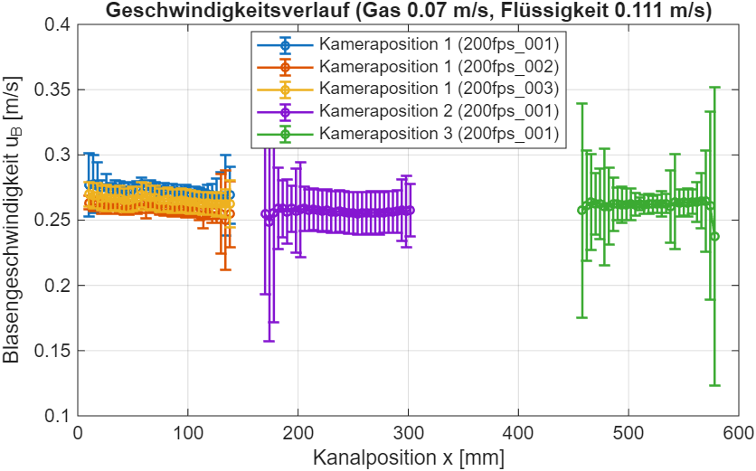
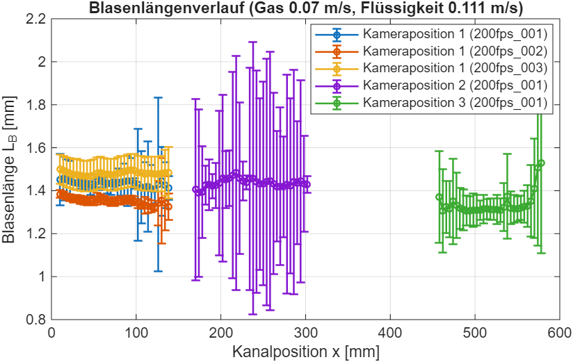
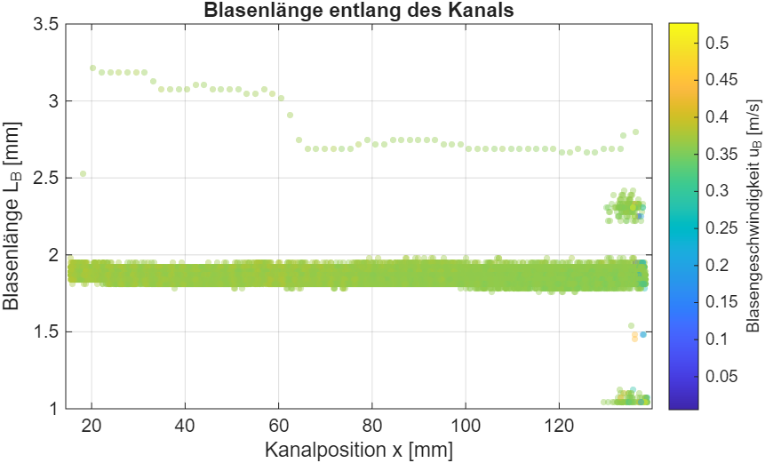
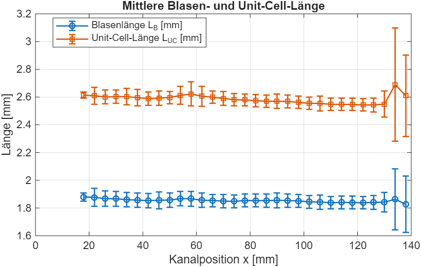
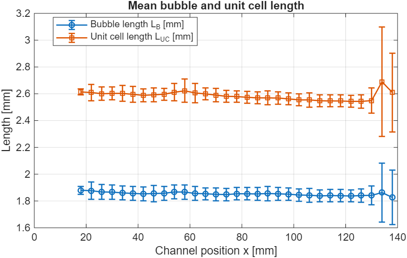
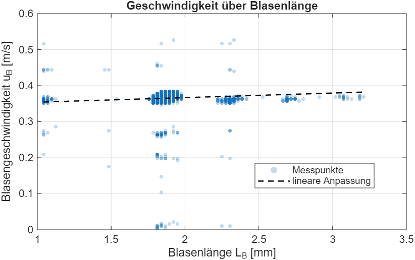
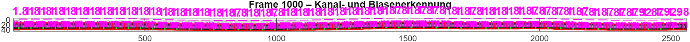
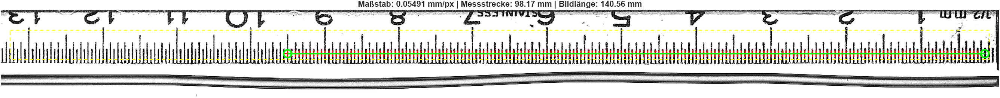
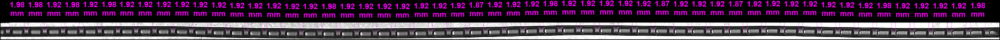

# 5 Plots

Alle Plots entstehen über Funktionen in `+videoauswertung/+plots` mit einem
gemeinsamen Stil (`PlotStil`): Größe in cm, Beschriftung Deutsch oder
Englisch, PNG und PDF, immer helles Theme. Einstellungen in `cfg.plots`
(Kapitel 3.8).

```matlab
stil = videoauswertung.plots.PlotStil(config());   % Stil aus config.m
stil.Sprache = 'en';                               % für diesen Plot ändern
fig = videoauswertung.plots.plot_Profil(bins, stil);
stil.speichere(fig, 'output/profil');              % profil.png und profil.pdf
```

Jede Plotfunktion nimmt als letztes Argument optional eine Achse; dann
zeichnet sie dort hinein (so nutzt sie die Oberfläche).

Die Eingangsdaten stammen aus einer Auswertung:

```matlab
cfg = config();
[datei, rohdaten, bins] = videoauswertung.kern.auswerten_Einzel(cfg, video);   % ein Video
tab = videoauswertung.plots.lies_Batchergebnis('output/Output_MassTransfer/Auswertung_Masse_….csv');  % Batch
```

## 5.1 Verlaufsplots je Einstellung (Batch)

Entstehen automatisch nach jedem Batch (`cfg.plots.batch = true`) im
Unterordner `plots` neben der Ergebnisdatei, je Kombination aus Gas- und
Flüssigkeitsgeschwindigkeit, Material, Form und Kanal.



**Aussage:** Blasengeschwindigkeit u_B je Bin (Mittelwert ± Standardabweichung)
über der Kanalposition, eine Linie je Kameraposition. Liegen mehrere
Aufnahmen desselben Messpunkts vor, erhält jede eine eigene Linie (hier
Position 1 mit drei Aufnahmen).



**Aussage:** Blasenlänge L_B entlang des Kanals; eine Abnahme zeigt den
Stoffübergang von CO₂ in die Flüssigkeit.

```matlab
sel = tab.GasVelocity == "0.07" & tab.LiquidVelocity == "0.111" & tab.Material == "PTFE";
videoauswertung.plots.plot_Verlauf(tab(sel, :), 'Speed_m_s', stil);        % oder 'BubbleLength_mm'
videoauswertung.plots.erzeuge_Batchplots('output/…/Auswertung_….csv', stil); % alle Einstellungen einer Datei
```

## 5.2 Plots eines Einzelvideos

Erzeugt von `run_Einzel` und im GUI-Tab „Ergebnisse“.



**Aussage:** jeder Messpunkt (eine Blase zwischen zwei Frames). Ausreißer
nach oben oder unten sind Fehlerkennungen einzelner Frames; sie gehen
gewichtet mit ihrer Anzahl in die Bins ein.
Aufruf: `plot_Laenge_Position(rohdaten, stil)`.



**Aussage:** Bin-Mittelwerte von L_B und L_UC mit Standardabweichung, nur
in der stabilen Messzone. Aufruf: `plot_Profil(bins, stil)`.





**Aussage:** Zusammenhang zwischen Blasenlänge und Geschwindigkeit mit
linearer Anpassung. Aufruf: `plot_Geschwindigkeit_Laenge(rohdaten, stil)`.

## 5.3 Kontrollansichten



**Live-Ansicht** (`cfg.anzeige.live`): prüft während der Auswertung, ob
Kanal und Blasen richtig erkannt werden. Aufruf als Rückmeldung:
`rueck.live = @(I, seeds, det, px2mm, frame) videoauswertung.plots.zeige_Live(ax, I, seeds, det, px2mm, frame)`.



**Kalibrierkontrolle** (`cfg.anzeige.kalibrierung`): prüft, ob das Lineal
richtig erkannt wurde. Der Titel nennt Maßstab, Messstrecke und Bildlänge.

## 5.4 Methodik-Abbildungen

Mit `cfg.abbildungen.exportieren = true` entstehen für das Frame
`cfg.abbildungen.frame` die Bilder der einzelnen Verarbeitungsschritte in
`cfg.pfade.abbildungen` (Kapitel 7):

| Datei | Schritt |
|---|---|
| `Abb1_Original.png` | Grauwertbild |
| `Abb2_Kontrast.png` | nach Kontrastausgleich und Median |
| `Abb3_Binaer.png` | nach adaptiver Schwelle und Schließen |
| `Abb5_Kanalgeometrie.png` | Kanalwände (rot) und Mittellinie (cyan) |
| `Abb6_Raycasting_Kanten.png` | Suchstrahlen (magenta), Blasenkanten (rot), Slugkanten (grün) |
| `Abb7_RegionGrowing_Maske.png` | Füllmaske mit Saatpunkten (blau) |
| `Abb8_Gefuellt.png` | gefüllte Blasen |
| `Abb9_FinaleMessung.png` | Bemaßung jeder Blase in mm |


