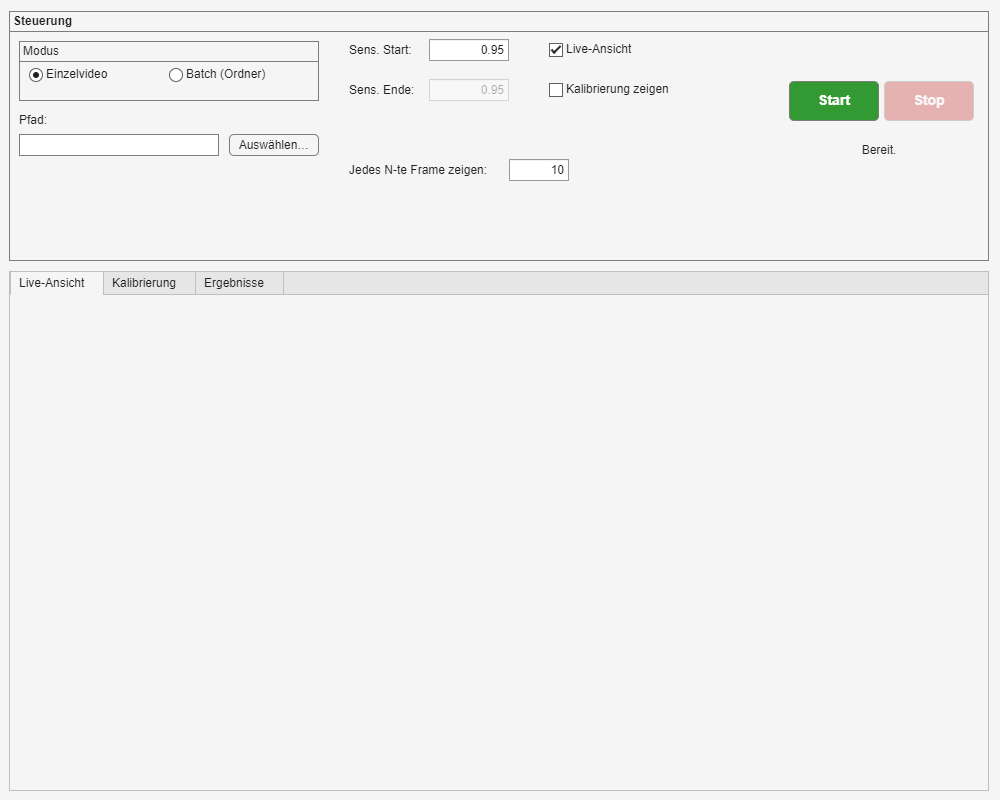
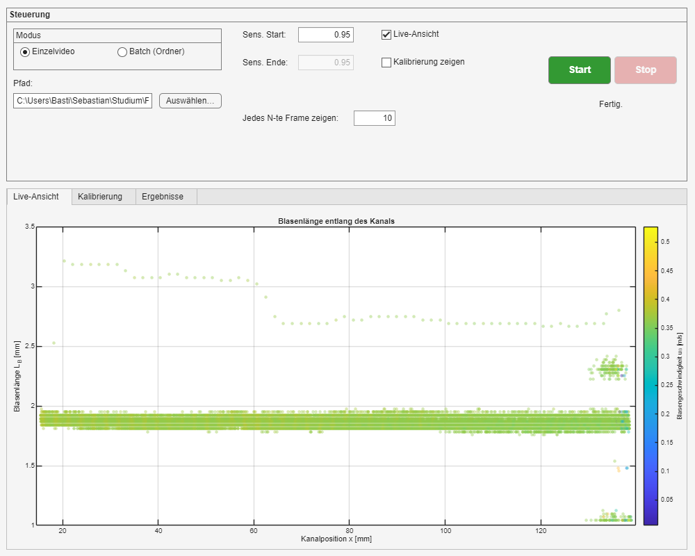
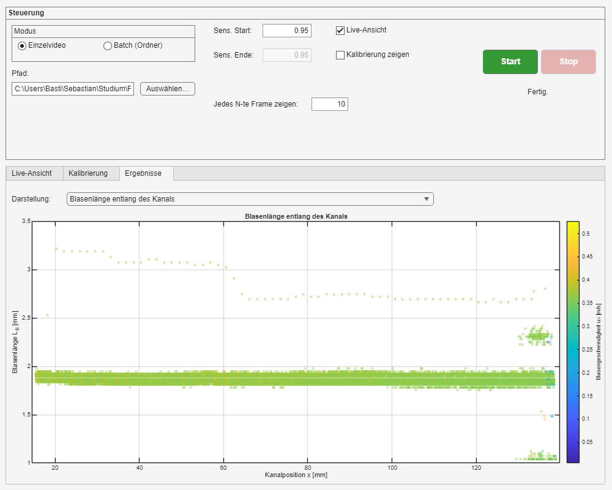
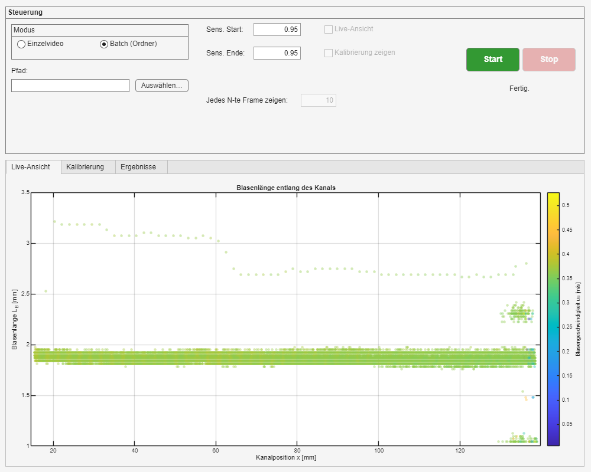
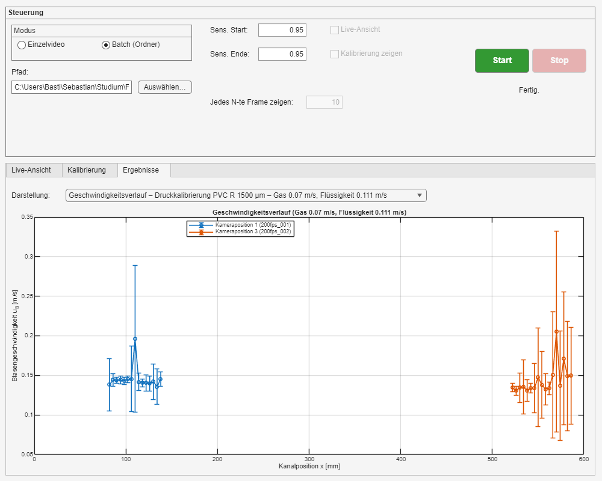

# 6 Bedienoberfläche

Die Oberfläche bedient dieselben Funktionen wie die Skripte
(`videoauswertung.kern.auswerten_Einzel` bzw. `auswerten_Batch`) und
liefert dieselben Ergebnisse; der Test `tests/test_GuiLauf.m` prüft das
bytegenau.

Start in MATLAB im Projektordner:

```matlab
Start_App
```

## 6.1 Einzelvideo



1. **Modus** „Einzelvideo“ wählen.
2. **Auswählen…** und das Messvideo (`.avi`) im Aufnahmeordner wählen.
3. Bei Bedarf **Sens. Start** ändern (Sensitivität der Schwelle).
4. **Live-Ansicht** zeigt jedes N-te Frame mit erkannten Kanalwänden
   (rot), Blasengrenzen (grün/rot) und Blasenlänge in mm.
   **Kalibrierung zeigen** zeichnet das Kontrollbild des Lineals in den Tab
   „Kalibrierung“.
5. **Start**. Nach dem Lauf wechselt die Oberfläche in den Tab
   „Ergebnisse“.





Über **Darstellung** lassen sich die drei Plots des Einzelvideos
umschalten (Kapitel 5).

## 6.2 Batch



1. **Modus** „Batch (Ordner)“ wählen.
2. **Auswählen…** und den Messordner wählen (z. B. `PTFE_1000_600`).
3. **Sens. Start** und **Sens. Ende**: Mit gleichen Werten wird einmal
   ausgewertet; mit verschiedenen Werten wird jedes Video für jede
   Sensitivität im Abstand `cfg.gui.sens_schritt` (0,05) ausgewertet
   (Spalte `UsedSensitivity`).
4. **Start**. Ein Balken zeigt den Fortschritt (Videos fertig / gesamt).
   Live-Ansicht und Kalibrierkontrolle sind im Batch abgeschaltet.
5. Im Tab „Ergebnisse“ steht je Einstellung der Geschwindigkeits- und
   Blasenlängenverlauf zur Auswahl.



**Stop** bricht den Lauf ab. Im Batch werden dabei die parallelen Worker
beendet; bereits fertige Videos werden nicht gespeichert. Im Einzelmodus
greift Stop beim nächsten angezeigten Frame (nur mit Live-Ansicht).

## 6.3 Zuordnung der Bedienelemente

| Element | Wirkt auf | Startwert aus |
|---|---|---|
| Modus | `auswerten_Einzel` oder `auswerten_Batch` | – |
| Pfad / Auswählen… | Messvideo bzw. Messordner; der Dialog öffnet in `cfg.pfade.messdaten` | – |
| Sens. Start | `cfg.detektion.sens` (Einzel) bzw. Beginn des Sweeps (Batch) | `cfg.detektion.sens(1)` |
| Sens. Ende | Ende des Sweeps (nur Batch) | `cfg.detektion.sens(end)` |
| Jedes N-te Frame zeigen | `cfg.anzeige.jedes_n_frame` | `config.m` |
| Live-Ansicht | `cfg.anzeige.live` | an |
| Kalibrierung zeigen | `cfg.anzeige.kalibrierung` | aus |
| Start / Stop | Lauf starten / abbrechen | – |
| Tab Live-Ansicht | `plots.zeige_Live`, im Batch Fortschrittsbalken | – |
| Tab Kalibrierung | `plots.zeige_Kalibrierung` | – |
| Tab Ergebnisse | `plot_Laenge_Position`, `plot_Profil`, `plot_Geschwindigkeit_Laenge` bzw. `plot_Verlauf` | – |

Alle übrigen Einstellungen (Pfade, Detektion, Plots) kommen unverändert aus
`config.m`. Die Oberfläche kann auch mit geänderten Einstellungen gestartet
werden:

```matlab
cfg = config();
cfg.plots.sprache = 'en';
videoauswertung.gui.VideoAnalysisApp(cfg);
```

## 6.4 Einen GUI-Lauf per Skript wiederholen

Jeder Lauf, aus der Oberfläche wie aus einem Skript, schreibt seine
vollständigen Einstellungen nach `output/lauf_config_<Zeit>.json`
(Laufart, Ziel, Zeit, Code-Stand und alle `cfg`-Einträge). Wiederholen:

```matlab
videoauswertung.kern.wiederhole_Lauf('output/lauf_config_20261014_201500.json')
```

oder mit eigenem Ausgabeordner, um die Ergebnisse zu vergleichen:

```matlab
videoauswertung.kern.wiederhole_Lauf('output/lauf_config_….json', 'output/wiederholung')
```

Die Einstellungen lassen sich auch nur laden und weiter verwenden:

```matlab
[cfg, lauf] = videoauswertung.io.lade_Laufconfig('output/lauf_config_….json');
```

## 6.5 Fehlermeldungen

Fehler aus der Auswertung erscheinen als Meldungsfenster mit dem Text der
Ursache, die Statuszeile zeigt „Fehler!“. Im Batch werden einzelne
fehlerhafte Videos dagegen nur übersprungen; die Gründe stehen im
MATLAB-Befehlsfenster (`ÜBERSPRUNGEN: …`, Kapitel 4.4).
