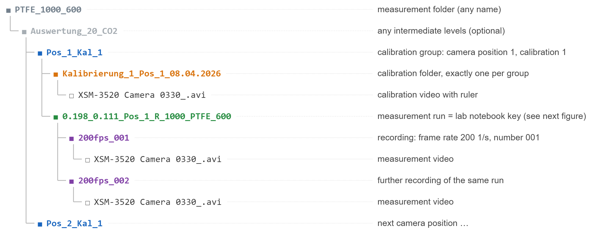
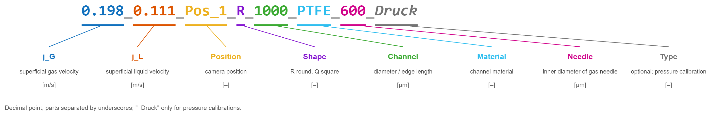

# 2 Measurement data

The program finds videos, calibration and metadata solely through folder
names and the lab notebook. This chapter describes what both must look
like and how a new measurement series is added.

## 2.1 Folder structure

The colours mark the levels the program recognises. Only the calibration
group, the calibration folder, the measurement run and the recording follow
fixed naming rules; measurement folders and intermediate levels can be
named freely.

**Calibration group `Pos_<n>_Kal_<k>`.** Camera position n and number k of
the calibration. Below a group folder there must be exactly one calibration
video, inside a folder whose name starts with `Kalibrierung_`
(`cfg.kalibrierung.ordnermuster`). All measurement runs below it use this
calibration video. If it is missing or there are several, the evaluation of
that video stops with a message.

**Measurement run.** The folder name is the key into the lab notebook and
contains the settings of the experiment:

Without the suffix `_Druck` the measurement is treated as a mass transfer
measurement (`Massentransfer`); with it, as a pressure calibration
(`Druckkalibrierung`).

**Recording `<n>fps_<nnn>`.** Frame rate n [1/s] and sequence number.
Several recordings of the same measurement run are evaluated separately and
distinguished in the column `Aufnahme`. If the video lies directly in the
measurement run folder, the frame rate `cfg.video.fps` applies.

**Video file.** The program looks for files matching `cfg.video.dateimuster`
(default `XSM-3520 Camera 0330_*.avi`). Other camera files (`.mii`, `.mme`,
`.xsv`) are not read.

## 2.2 Lab notebook

File `data/Laborbuch.csv` (`cfg.pfade.laborbuch`), semicolon-separated,
decimal point, one row per measurement run. Required columns (the column
names are German):

| Column | Meaning | Unit | Example |
|---|---|---|---|
| `Dateiname` | name of the measurement run folder (key) | – | `0.198_0.111_Pos_1_R_1000_PTFE_600` |
| `Offset` | position of the right image edge in the reactor | mm | `0` |
| `Umgebungsdruck` | pressure at the outlet | Pa | `101610` |
| `Umgebungstemperatur` | ambient temperature | °C | `22.1` |
| `CO2-Anteil` | mole fraction of CO₂ in the gas | – (0…1) | `0.2` |
| `Kanallaenge` | length of the reactor | cm | `72` |

If the row is missing or a required value is empty, the batch skips the
video with a warning (`ÜBERSPRUNGEN: …` = skipped, in the log); the single
evaluation stops with the same message. Other columns of the lab notebook
are not read.

For pressure calibrations, `cfg.laborbuch.co2_anteil_druck` sets the CO₂
fraction independently of the lab notebook (default 0, see chapter 3).

If a `Dateiname` appears twice in the lab notebook, the first row is used.

## 2.3 Adding a new measurement series

1. Store the videos in the structure from 2.1, e.g. as a new measurement
   folder `PVC_1500_1150/` in the project folder. One folder
   `Pos_<n>_Kal_<k>` per camera position and calibration, each with exactly
   one calibration folder.
2. Add one row per measurement run to the lab notebook (required columns
   from 2.2). `Dateiname` must match the folder name exactly.
3. Enter the measurement folder in `run_Batch.m` and run `run_Batch`.
4. Check the log:
   - `Gruppe Pos_…: … mm/px` or `Kalibrierdatei: …` – calibration found
   - no `ÜBERSPRUNGEN` (skipped) lines for the new runs
   - `ERFOLG: … Zeilen gespeichert in …` – result file written
5. Look at the results in `output/` and the plots in `output/…/plots/`
   (chapters 4 and 5).

If the measurement data are not in the project folder, set
`cfg.pfade.messdaten` in `config.m` to the folder that contains the
measurement folders.

## 2.4 Excluding measurements

A measurement run is not evaluated if its row is missing from the lab
notebook. To exclude it, remove the row or move the folder out of the
measurement folder, and note the reason in the lab notebook (column
`Kommentar`).
