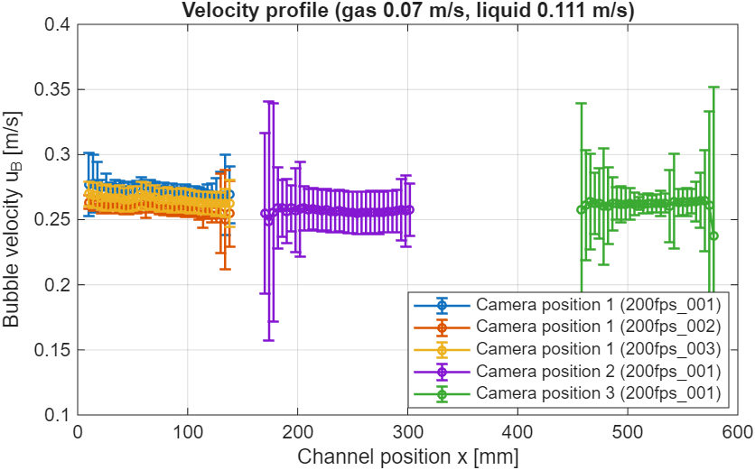
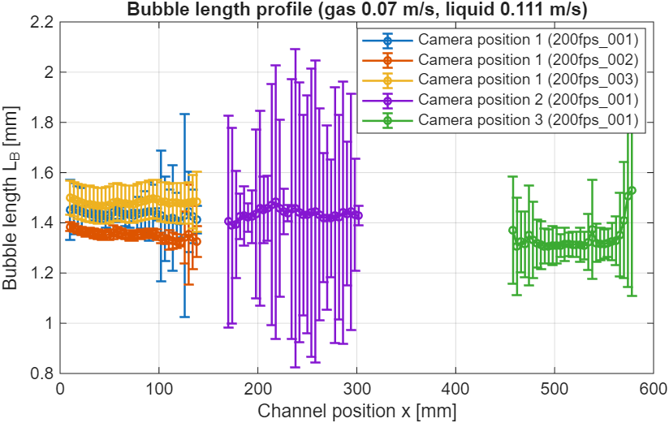
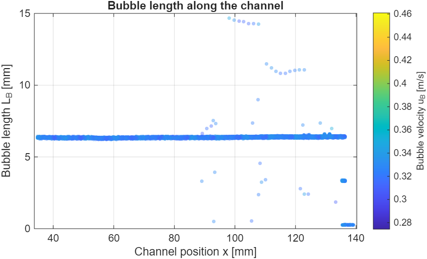
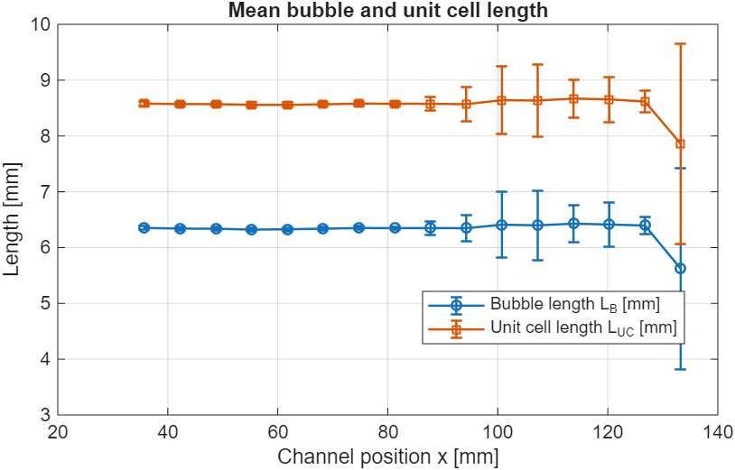
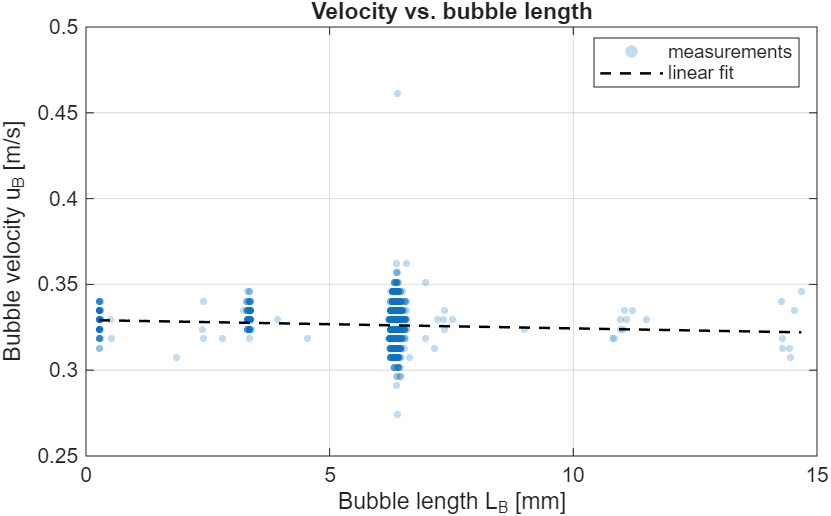
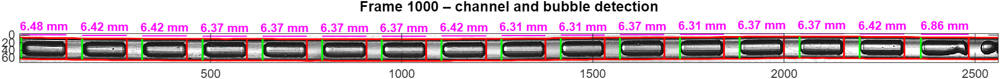
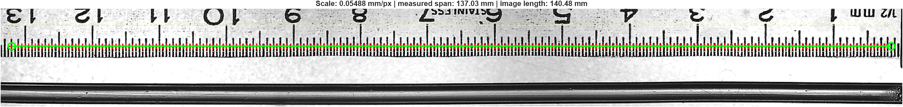

# 5 Plots

All plots are produced by functions in `+videoauswertung/+plots` with a
common style (`PlotStil`): size in cm, German or English labels
(`cfg.plots.sprache = 'en'` labels all plots in English), PNG and PDF,
always a light theme. Settings in `cfg.plots` (chapter 3.8). The figures in
this manual use English labels.

```matlab
stil = videoauswertung.plots.PlotStil(config());   % style from config.m
stil.Sprache = 'en';                               % change for this plot
fig = videoauswertung.plots.plot_Profil(bins, stil);
stil.speichere(fig, 'output/profil');              % profil.png and profil.pdf
```

Every plot function optionally takes an axes object as last argument and
then draws into it (this is how the user interface uses them).

The input data come from an evaluation:

```matlab
cfg = config();
[datei, rohdaten, bins] = videoauswertung.kern.auswerten_Einzel(cfg, video);   % one video
tab = videoauswertung.plots.lies_Batchergebnis('output/Output_MassTransfer/Auswertung_Masse_….csv');  % batch
```

## 5.1 Profile plots per setting (batch)

Created automatically after every batch (`cfg.plots.batch = true`) in the
subfolder `plots` next to the result file, for every combination of gas and
liquid velocity, material, shape and channel.



**Interpretation:** bubble velocity u_B per bin (mean ± standard deviation)
over the channel position, one line per camera position. If there are
several recordings of the same measuring point, each gets its own line
(here position 1 with three recordings).



**Interpretation:** bubble length L_B along the channel; a decrease shows
the mass transfer of CO₂ into the liquid.

```matlab
sel = tab.GasVelocity == "0.07" & tab.LiquidVelocity == "0.111" & tab.Material == "PTFE";
videoauswertung.plots.plot_Verlauf(tab(sel, :), 'Speed_m_s', stil);        % or 'BubbleLength_mm'
videoauswertung.plots.erzeuge_Batchplots('output/…/Auswertung_….csv', stil); % all settings of one file
```

## 5.2 Plots of a single video

Produced by `run_Einzel` and in the user interface tab "Ergebnisse"
(results).



**Interpretation:** every data point (one bubble between two frames).
Outliers above or below are misdetections in single frames; they enter the
bins weighted by their number. Call: `plot_Laenge_Position(rohdaten, stil)`.



**Interpretation:** bin means of L_B and L_UC with standard deviation, only
in the stable measurement zone. Call: `plot_Profil(bins, stil)`.



**Interpretation:** relation between bubble length and velocity with a
linear fit. Call: `plot_Geschwindigkeit_Laenge(rohdaten, stil)`.

## 5.3 Check views for troubleshooting

If the results look implausible, two views show whether the channel, the
bubbles and the ruler were detected correctly. Both can be switched on in
the user interface (chapter 6) and can also be produced in a script.



**Live view** (`cfg.anzeige.live`, user interface tab "Live-Ansicht"):
every n-th frame with the detected channel walls (red), the bubble
boundaries (green left, red right) and the measured bubble length. If the
red lines do not lie on the channel walls or bubbles are missing, the
sensitivity (`cfg.detektion.sens`) usually needs adjusting. In a script:
`run_Einzel`.



**Calibration check** (`cfg.anzeige.kalibrierung`, user interface tab
"Kalibrierung"): the first frame of the calibration video with the detected
ruler ticks. The title gives the scale, the measured span and the image
length; a scale clearly outside about 0.054–0.055 mm/px (current camera
setup) indicates a misdetection.
